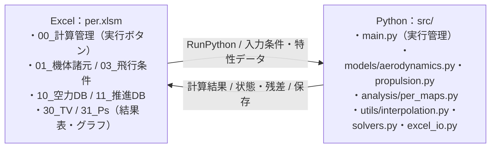

# Excel + Python 推算：構成例

**目的**：Excel (`.xlsm`) を入力・特性DB・結果表・グラフに使い、Pythonを補間・求根・性能計算のエンジンにする。

これは「T–V / Ps 計算」までを実装した**動作例**です。離陸・上昇・巡航・降下・着陸の解析は今後追加する前提です。

## 1. システム構成図（ExcelとPythonを各1つの枠で表現）



## 2. フォルダ構造

```text
per/
├── per.xlsm      # 利用者が用意（このZIPには含めない）
├── src/
│   ├── main.py                  # RunPythonからの入口
│   ├── legacy_examples.py       # 過去のmain.run() 等の互換用
│   ├── models/
│   │   ├── aerodynamics.py      # 空力DBから係数補間モデルを1回構築
│   │   └── propulsion.py        # 推進DBから推力補間モデルを1回構築
│   ├── analysis/
│   │   └── per_maps.py  # T–V、Ps の簡易計算
│   └── utils/
│       ├── interpolation.py     # 既存のExcelInterpolator（v5そのまま）
│       ├── solvers.py           # 既存のEquationSolver
│       └── excel_io.py          # 既存のwrite_excel_result、NaN → =NA()
├── tests/
├── requirements.txt                 # 方式A用
├── requirements_without_xlwings.txt # 方式B専用
└── README.md
```

`models/aerodynamics.py` と `models/propulsion.py` は `ExcelInterpolator` をラップします。**ほかのファイルは補間クラスを直接何度も生成せず、既に作成済みの `aero` / `propulsion` オブジェクトを受け取って呼び出します。**

```python
# src/main.py の要点

aero = AerodynamicsModel(excel_path=wb.fullname, workbook=wb)
propulsion = PropulsionModel(excel_path=wb.fullname, workbook=wb)

df = calculate_tv_ps(
    aero, propulsion,
    mass_kg=40.0,
    wing_area_m2=2.0,
    rho_kg_m3=1.225,
    speed_of_sound_m_s=340.0,
    altitude_m=0.0,
    velocities_m_s=[20, 25, 30, 35, 40],
)
```

空力・推進モデルの **補間器はこの実行内でそれぞれ1回構築**します。`calculate_tv_ps` の速度ループではPythonメモリ上の補間モデルを評価します。

## 3. Excelシートとセル位置

| シート名 | セル／列 | 値 | 備考 |
|---|---|---|---|
| `00_計算管理` | B2 | 状態 | 計算中・完了・エラー |
| | B3 | 最終正常計算日時 | Pythonが書き込み |
| | B4 | 実行メッセージ | Pythonが書き込み |
| `01_機体諸元` | B2 | 質量 [kg] | 入力またはExcel数式 |
| | B3 | 主翼面積 [m²] | 入力またはExcel数式 |
| `03_飛行条件` | B2 | 空気密度 [kg/m³] | 入力またはExcel数式 |
| | B3 | 音速 [m/s] | 入力またはExcel数式 |
| | B4 | 飛行高度 [m] | 入力 |
| | B5 | 最小速度 [m/s] | 入力 |
| | B6 | 最大速度 [m/s] | 入力 |
| | B7 | 速度点数（2～10000） | 入力 |
| `10_空力DB` | A1～ | `alpha`, `Mach`, `CL`, `CD`, `Cm` | ヘッダー1行目。**α×Machの全格子点** |
| `11_推進DB` | A1～ | `V`, `Altitude`, `Thrust` | ヘッダー1行目。**V×Altitudeの全格子点** |
| `30_TV` | A5～ | `V`, `T_required`, `T_available`, `alpha`, `status` | Python書き込み |
| `31_Ps` | A5～ | `V`, `Ps`, `alpha`, `status` | Python書き込み |

列名の大文字・小文字はコードと一致させてください。出力領域は `A5:E10005` 等を初期化するため、この範囲に入力値・Excel数式・グラフを配置しないでください。グラフは列の右側に配置する想定です。

`10_空力DB` または `11_推進DB` が不規則な散在点データであれば、`models/` 側の `method="regular_grid"` をデータに合わせて `"rbf"` 等に変更します。**RBFなら無制限に外挿してよいという意味ではありません。**

## 4. Excel側の実行ボタン

`per.xlsm` の標準モジュールに以下を登録し、フォームコントロールのボタンに割り当てます。

```vb
Sub RunMaps()
    RunPython "import main; main.run_maps()"
End Sub
```

xlwingsアドイン（またはStandalone VBAモジュール）の設定で、**PYTHONPATHにこのプロジェクトの `src` フォルダ**を設定してください。

例：`C:\per\src`

`xw.Book.caller()` がボタンを押したブックを参照するため、Excelパスを `main.py` に固定する必要はありません。Python環境の配置と実行権限、xlwingsアドインまたはStandaloneモジュール、マクロ許可は別途必要です。

## 5. Excelグラフの作成方法

Excelの **XY散布図** を使います。補間や性能計算をPython側で行った結果セルを参照するため、PNG画像ではありません。

- `30_TV`：横軸X=`A6:A(5+N)`、必要推力Y=`B6:B(5+N)`、利用可能推力Y=`C6:C(5+N)`
- `31_Ps`：横軸X=`A6:A(5+N)`、比剰余出力Y=`B6:B(5+N)`

N（速度点数）が頻繁に変わる場合は、Excelテーブル・動的名前付き範囲・VBA等で参照範囲を更新してください。**単に固定範囲でグラフを作ると増えた行が表示されない**ことがあります。

`#N/A` になる数値は `write_excel_result` が `=NA()` で出力します。例えば迎角の解がない速度ではグラフに欠損点が現れます。Excelのグラフ種類・バージョンにより欠損点の結線設定は確認してください。

## 6. モデルから解析へ渡す設計

`src/models/aerodynamics.py` の目的は「空力特性データを読む」「必要な条件でCL, CD, Cmを返す」ことです。

```python
# 一回だけ生成
aero = AerodynamicsModel(excel_path=wb.fullname, workbook=wb)

# 計算ファイルから呼ぶ場合、aeroインスタンスを渡す
coefficients = aero.coefficients(alpha=5.0, mach=0.2)
CL = coefficients["CL"]
CD = coefficients["CD"]
```

今後 `analysis/trim.py`、`analysis/climb.py`、`analysis/cruise.py` を追加するときは、`aero` を引数に渡してください。これらのファイルが `ExcelInterpolator` を各自構築する設計は避けます。

なお、データ更新後の次の実行では新しいモデルを生成するため、通常のExcelボタン運用で `reload()` を明示する必要はありません。

## 7. 本例の計算上の制限（重要）

**これはシステム連携を示すサンプルであり、実機の飛行性能推算の完成形ではありません。**

- 定常水平飛行・単純化した力の釣合い：`CL_required = W/(q S)`、`q = ρ V²/2`
- 求根：`CL(α,Mach) - CL_required = 0` の1変数方程式を `EquationSolver` の `brentq` で求める。
- `T_required ≈ D = q S CD` とし、`Ps = (T_available-D) V/W` とする。
- 迎角のみを求めており、**Cm=0と舵角を求める完全な縦トリム計算ではありません**。
- 推力データは固定出力状態での `Thrust(V,Altitude)` を仮定。プロペラ機では回転数、パワー、プロペラ効率等を加味するモデルに拡張が必要。
- マップ外や釣合い解なしは出力をNaNにし、Excelでは `#N/A` となる。入力データの構造不備などは例外で停止する。
- 複数の入力・出力で入力単位系・係数符号・基準翼面積・モーメント基準点を揃える必要がある。
- 大量のExcelのセル通信は遅いため、データベースの読み込みと結果の書き込みはなるべく一括で行う。

## 8. インストール・テスト

```bash
python -m pip install -r requirements.txt
python -m pip install pytest
python -m pytest -q tests/
```

テストは実際の `.xlsx` 形式の仮の入力テーブルを `openpyxl` で作成し、空力・推進モデル、求根、T–V/Ps計算、Excel書き込みの模擬処理を検証します。**Excel実機でのマクロボタン・アドイン操作は未検証**です。

### 互換性

従来の v5 のサンプル `main.run()` / `main.run_intersection_example()` は `legacy_examples.py` 経由で呼び出せます。ただし、それらは旧シート名（`空力DB`、`エンジンDB` 等）を使うため、新しい `run_maps()` の構成とは区別してください。


---

## 9. ExcelからPythonを起動する：アドイン不要の2方式（Windows版Excel）

この節は、**Excelのボタンを押してPythonを動かし、T–V / Psの数値表をExcelに保存するまで**の再現手順です。
`per.xlsm` は利用者が作成します（この配布物には空の `.xlsm` を含めていません）。

### 9.1 どちらを選ぶか

| 項目 | **A. xlwings Standalone** | **B. VBAでPythonコマンドを直接起動** |
|---|---|---|
| Excelアドインのインストール | **不要** | **不要** |
| Excel側のxlwingsコード | ブックに組み込むVBAモジュールが必要 | **不要** |
| Python側で使うライブラリ | xlwings + NumPy / SciPy等 | **openpyxl** + NumPy / SciPy等（xlwings不要） |
| Pythonの入口 | `src/main.py` の `run_maps()` | `src/run_without_xlwings.py` |
| Excelデータの読み取り | `xw.Book.caller()` により**開いているブックを直接読む** | Excelが一度**保存**したブックをファイルとして読む |
| Excelへの結果の戻し方 | Pythonから開いているセルへ直接書き込む | Pythonが別の一時`.xlsx`を出力、VBAが転記 |
| 未保存の値 | 直接参照可能 | VBAで保存してから実行 |
| 結果グラフ | Excelのセルを更新すると再描画 | 同左 |
| 開発負荷 | **低い** | やや高い（戻し込み／例外処理が必要） |
| 推奨 | **今回の第一候補** | アドイン・xlwings両方を使いたくない場合 |

どちらも **ローカルのWindowsデスクトップ版Excel、VBAが実行可能な環境**を前提とします。
Python実行環境は各PCに必要で、VBAと外部プログラム実行が会社のポリシーで禁止されていないことを確認してください。
**Excel Online/ブラウザ版**では、このVBA実行方法は使用できません。

#### 共通：プロジェクト配置

```text
C:\per\
├── per.xlsm
├── .venv\                     # Pythonの仮想環境（利用者が作成）
│   └── Scripts\python.exe
├── src\
│   ├── main.py                 # 方式A
│   ├── run_without_xlwings.py  # 方式B
│   ├── models\ ...
│   ├── analysis\ ...
│   └── utils\ ...
├── excel_vba\
│   ├── RunMaps_xlwings.bas
│   └── RunMaps_without_xlwings.bas
├── requirements.txt                 # 方式A用
├── requirements_without_xlwings.txt # 方式B専用
└── README.md
```

**共通の初期セットアップ：** Windowsの**コマンドプロンプト（cmd.exe）**で実行します。例ではWindowsの`py`コマンドを使います。

```bat
cd /d C:\per
py -m venv .venv
REM 方式Aの場合
.venv\Scripts\python.exe -m pip install -r requirements.txt
REM 方式Bだけの場合（xlwingsを入れない）
REM .venv\Scripts\python.exe -m pip install -r requirements_without_xlwings.txt
.venv\Scripts\python.exe -m pip install pytest
.venv\Scripts\python.exe -m pytest -q tests
```

`py` がない場合、PATHにある `python` コマンドを使用してください。既存の仮想環境があればそれを利用して構いません。
`requirements.txt` は方式A用でxlwingsを含みます。**方式Bだけ**使う場合は、代わりに `requirements_without_xlwings.txt` をインストールしてください。

### 9.2 方式A：xlwings Standalone（アドインなし・開いているExcelを直接操作）

xlwings公式の `--standalone` は、Excelアドインの代わりになるVBAモジュールをブック内に持たせる方式です。Excel側のアドインインストールは不要ですが、**ブック内のxlwings VBAモジュールは必要**です。

**手順 A-1. Standaloneの雛形を生成する**

```bat
cd /d C:\per
.venv\Scripts\xlwings.exe quickstart StandaloneSeed --standalone
```

`StandaloneSeed\StandaloneSeed.xlsm` などが生成されます。これは**既存の `per.xlsm` を上書きするコマンドではありません**。既存ブックに組み込むための雛形です。

**手順 A-2. 内蔵VBAモジュールを既存ブックに移す**

1. `StandaloneSeed.xlsm` と `per.xlsm` を **Windows版Excel** で開く。
2. `Alt + F11` でVBAエディターを開く。
3. 左のプロジェクトエクスプローラーで雛形ブックの標準モジュールを確認し、xlwings用のモジュールを右クリックして **[ファイルのエクスポート]** で `.bas` を書き出す。
4. `per.xlsm` のプロジェクトを選び **[ファイル] → [ファイルのインポート]** で、その `.bas` を組み込む（同名モジュールが既にある場合は重複させない）。
5. 雛形に含まれる専用の補助モジュールやクラスがあれば、それも必要に応じて移す。Windows版では通常は独立したVBAモジュールで利用できる。
6. `per.xlsm` を保存する。**.xlsmのまま保存**すること。

> 新規作成なら `StandaloneSeed.xlsm` を `per.xlsm` にリネームし、シートを追加して使い始めるほうが簡単です。既存ブックを使用する場合のみモジュール移植が必要です。

**手順 A-3. Pythonの場所とソースコードの場所を設定する**

`per.xlsm` に `xlwings.conf` という名前のワークシートを作り、次の2列で設定します。
（雛形の `_xlwings.conf` シートを利用する場合は、先頭の `_` を削除して `xlwings.conf` に変更してください。）

| A列（設定キー） | B列（値の例） |
|---|---|
| `INTERPRETER_WIN` | `C:\per\.venv\Scripts\python.exe` |
| `PYTHONPATH` | `C:\per\src` |

パスは**実際に配置したフォルダ**に変更します。仮想環境以外のPythonを使う場合は、その `python.exe` の実パスにします。ブックを別の場所に移動したら設定の変更が必要になることがあります。

**手順 A-4. マクロを登録する**

配布物の `excel_vba/RunMaps_xlwings.bas` を `Alt + F11 → ファイル → ファイルのインポート` から組み込むか、通常の標準モジュールに次のコードを貼り付けます。

```vb
Option Explicit

Public Sub RunMapsWithXlwings()
    On Error GoTo Failure
    RunPython "import main; main.run_maps()"
    MsgBox "計算が完了しました。", vbInformation
    Exit Sub
Failure:
    MsgBox "実行に失敗しました: " & Err.Description, vbExclamation
End Sub
```

ここで `RunPython` を提供するのは、**手順 A-2 でブック内に組み込んだxlwingsのVBAモジュール**です。Excelにアドインをインストールする必要はありません。

Python側は既存の `src/main.py` がそのまま使えます。

```python
# src/main.py （既存のエントリーポイント）
def run_maps():
    import xlwings as xw
    wb = xw.Book.caller()  # 呼び出し元ブック。パス指定不要
    # 以降、空力DB・推進DBの読み込み → 計算 → Excelへ書き込み
```

`main.py` の関数内で `xw.Book.caller()` を呼ぶのがポイントです。

**手順 A-5. Excel上のボタンと疎通確認**

[9.4](#94-excel上に計算実行ボタンを置く共通)の手順で、`00_計算管理` シートのフォームコントロールボタンに `RunMapsWithXlwings` を割り当てます。
クリック後、管理シート `B2` に「完了」、`30_TV` と `31_Ps` に数値が更新されたら成功です。

### 9.3 方式B：VBAのコマンド実行でPythonを起動（xlwings不使用）

**重要： `RunPython` と `xw.Book.caller()` はこの方式では使いません。**
VBAが `python.exe` を直接実行し、保存済みの `.xlsm` を `openpyxl` が読み、出力用の別 `.xlsx` を書きます。VBAがその結果を現在開いているExcelへ取り込みます。

計算中のPythonが、VBAで処理中のExcelへ直接COM接続して書き込もうとすると、競合や待機が起こり得ます。そこでこの例では、**ファイル受け渡し方式**にして安定性を優先しています。

**手順 B-1. Python環境とファイルを準備する**

9.1の構成にしたうえで、次を確認します。

```bat
C:\per\.venv\Scripts\python.exe
C:\per\src\run_without_xlwings.py
```

`src/run_without_xlwings.py` は**この配布物に含まれる**ため、新たに作る必要はありません。

**手順 B-2. コマンドプロンプトで単独実行を確認する**

一度Excelで `per.xlsm` を**保存**してから、次を実行します。

```bat
cd /d C:\per
.venv\Scripts\python.exe src\run_without_xlwings.py per.xlsm results_manual.xlsx
```

成功すると、`results_manual.xlsx` に `30_TV`、`31_Ps`、`00_計算管理` の結果シートが生成されます。元の `per.xlsm` はPythonから**上書きしません**。
エラー時は `results_manual.error.txt` に詳細が記録されます。

**手順 B-3. VBAモジュールを取り込む**

`excel_vba/RunMaps_without_xlwings.bas` を、`Alt + F11 → ファイル → ファイルのインポート` で `per.xlsm` に追加します。
このモジュールは**xlwingsの関数を使いません**。
コード内で呼ぶコマンドの中心は次のとおりです。

```vb
pyExe = ThisWorkbook.Path & "\.venv\Scripts\python.exe"
scriptPath = ThisWorkbook.Path & "\src\run_without_xlwings.py"

command = """" & pyExe & """ """ & scriptPath & """ """ & _
          ThisWorkbook.FullName & """ """ & resultPath & """"

ret = CreateObject("WScript.Shell").Run(command, 1, True)
```

最後の `True` はPythonの終了まで待機する指定です。`Shell` だけでは原則として完了を待たないため、ここでは `WScript.Shell.Run` を使います。
**上の抜粋のみでは結果の取り込み処理がありません。** 配布した `.bas` ファイルには、次の処理まで実装しています。

1. Excelの数式を再計算して `ThisWorkbook.Save` で保存する。
2. VBAからPythonのコマンドを起動し、完了まで待つ。
3. Pythonの終了コードと出力ファイルの有無を確認する。
4. 一時 `.xlsx` を読み、`30_TV` と `31_Ps` の結果を開いているExcelにコピーする。
5. `=NA()` を **数式として**コピーし、`#N/A` を維持する。
6. Excelを再計算・保存し、完了メッセージを表示する。

Python側は `openpyxl.load_workbook(path, data_only=True)` を使うため、Excel数式の**計算済みの値**を読み込みます。`openpyxl` 自身にExcel数式を再計算する機能はありません。式を変更した後はExcelで再計算し、**保存してから**Pythonへ渡す必要があります。このためVBAが計算前に保存します。

**手順 B-4. ボタンへ登録・実行する**

[9.4](#94-excel上に計算実行ボタンを置く共通)に従い、`00_計算管理` のボタンに `RunMapsWithoutXlwings` を割り当てます。
結果表とグラフが更新されれば成功です。

**本方式の注意点：**

- `ThisWorkbook.Path` に `.venv` と `src` があることが前提です。異なる配置なら `.bas` 内のパスを変更してください。
- Excelが開いている**同じ `.xlsm` をPythonのopenpyxlで上書きしません**。これによりマクロ・図形・グラフの破損やファイル競合を避けます。
- Excelの `=NA()` は `openpyxl` の読み込みではExcelのエラー値として現れ、補間クラスの欠損値処理の対象になります。
- VBAによる読み戻しでは計算結果の **A5:E10005 / A5:D10005** 領域を更新します。グラフをその領域に配置しないでください。
- ログはWindowsの `%TEMP%` 下に出力するため、機密データを扱う環境ではログファイルの保存・削除ポリシーを決めてください。

### 9.4 Excel上に「計算実行」ボタンを置く（共通）

**手順：**

1. `per.xlsm` をExcelで開きます。**デスクトップ版**を使用してください。
2. `[ファイル] → [オプション] → [リボンのユーザー設定]` で `[開発]` にチェックを入れます。
3. `Alt + F11` でVBAエディターを開き、方式AまたはBのマクロが標準モジュールに登録されているか確認します。
4. Excelの `00_計算管理` シートへ戻り、`[開発] → [挿入] → [フォームコントロール] → [ボタン]` を選びます。
5. シート上でドラッグし、ボタンを配置します。
6. 「マクロの登録」で、方式Aなら `RunMapsWithXlwings`、方式Bなら `RunMapsWithoutXlwings` を選択し `[OK]` を押します。
7. ボタンを右クリックして文字を `T–V / Ps 計算実行` に変更します。
8. `Ctrl + S` で `.xlsm` のまま保存します。
9. Excelの入力を設定してボタンをクリックします。正常なら `00_計算管理!B2` が「完了」になり、出力表を参照するXY散布図が更新されます。

**注意：** ボタンを通常クリックすると登録マクロが実行されます。割り当てを修正するときは、ボタンを右クリックして `[マクロの登録]` を選びます。ActiveXコントロールである必要はありません。

### 9.5 共通の確認項目・トラブルシューティング

| 症状 | 確認箇所 |
|---|---|
| `RunPython` が未定義 | **方式A**：StandaloneのVBAモジュールがブックに組み込まれているか確認。方式Bは `RunPython` 不要 |
| `No module named main` | **方式A**：`PYTHONPATH` が `...\src` を指すか確認 |
| `No module named scipy` / `xlwings` | `INTERPRETER_WIN` のPythonと `pip install` したPythonが一致しているか確認 |
| `Book.caller()` に接続できない | **方式A**：必ずExcelの `RunPython` から呼ぶ。方式Bでは使わない |
| `.venv\Scripts\python.exe` が見つからない | **方式B**：VBAの `pyExe` パスと環境を確認 |
| `.xlsx` の結果が作られない | **方式B**：`%TEMP%` の `.error.txt` を確認、単独コマンドで再現する |
| 読み込んだExcel数式セルが空 | **方式B**：Excelで再計算→保存してから実行。`openpyxl` は数式を計算しない |
| マクロを実行できない | Excelのマクロ設定、ファイルの信頼性、組織のポリシーを管理者と確認 |
| 結果表は変わるがグラフが更新されない | Excelのグラフ系列が `30_TV` / `31_Ps` の正しい結果範囲を参照しているか確認 |

**安全性について：** VBAマクロと外部プログラムの起動は、信頼できるプロジェクトでのみ許可してください。ネット経由のマクロファイルが既定でブロックされる環境もあります。セキュリティ設定を一律に無効化することは推奨しません。

### 9.6 関連する公式資料

- [xlwings：Add-in & Settings / Standalone VBA module](https://docs.xlwings.org/en/stable/addin.html)
- [xlwings：RunPython](https://docs.xlwings.org/en/stable/vba.html)
- [xlwings：Quickstart](https://docs.xlwings.org/en/stable/quickstart.html)
- [Microsoft：フォームコントロールボタンにマクロを割り当てる](https://support.microsoft.com/ja-jp/excel/assign-a-macro-to-a-form-or-a-control-button)
- [Microsoft：インターネットから取得したマクロファイルのブロック](https://learn.microsoft.com/ja-jp/microsoft-365-apps/security/internet-macros-blocked)

---

## 10. グラフの自動管理：`utils/excel_charts.py`

今回追加した `src/utils/excel_charts.py` は、**Pythonで計算済みのExcel表を参照するXY散布図**を作成・更新する関数群です。グラフの画像ファイルは生成しません。

**対応環境：Windows版デスクトップExcel + xlwings（Classic）**。ExcelのCOMネイティブAPIを使用します。macOS版Excel・Web版Excel・Excelなし環境では、このモジュールのグラフ操作は使用できません。VBAからの実行は前章の「xlwings Standalone方式」を利用できます。

### 10.1 使い分け

| API | 用途 |
|---|---|
| `update_chart_from_table(...)` | 1枚のシートの共通X列と複数Y列。T–V、Psなど |
| `update_xy_chart(...)` | 複数シート・異なるX列や行数の系列。生データと補間曲線の重ね表示など |
| `ExcelSeriesSpec(...)` | 各系列のシート名、列名、データ範囲、線／マーカーを定義 |
| `write_chart_table(...)` | 補間曲線など、グラフ専用の出力テーブルを更新（NaN → `=NA()`） |

### 10.2 T–V線図／Ps線図：行数が変わっても自動で同期

`main.py` に新たに `run_maps_with_charts()` を追加しました。これは既存の `run_maps()` でデータ計算・Excel出力を行った後、グラフも更新する入口です。

VBAのマクロ（xlwings Standaloneまたはアドイン方式）を次のようにします。

```vb
Sub RunMapsWithCharts()
    RunPython "import main; main.run_maps_with_charts()"
End Sub
```

このボタンを押すと、`30_TV!A5` と `31_Ps!A5` にある計算表を参照し、それぞれのシートに `TV_chart` と `Ps_chart` というXY散布図を作成／更新します。**既存グラフの位置や軸などは基本的に維持し、系列の参照範囲のみ現在の行数へ更新**します。

同じ処理を個別に呼ぶ場合：

```python
from utils.excel_charts import update_chart_from_table

update_chart_from_table(
    wb,
    chart_sheet="30_TV",         # Excelグラフの置き場所
    chart_name="TV_chart",       # 作成／更新するグラフ名
    data_sheet="30_TV",          # データ表のあるシート
    header_cell="A5",            # 見出し行の左端
    x_column="V",                # Excel上の列名
    y_columns=["T_required", "T_available"],
    row_count=len(tv_df),          # 行数を明示。Noneなら自動検出
    title="T–V",
)
```

- **各系列の横軸は数値のX軸**です。Excelの「折れ線グラフ（カテゴリ軸）」ではありません。
- `y_columns` を増減すると、系列が追加・削除されます。
- `row_count=None` なら、`header_cell` から連続する表の行数を検出します。途中に完全空白行がある場合や、隣接する別の表がある場合は、`row_count` を明示する方が確実です。
- グラフを含むブックへの保存は `wb.save()` で実行します。
- この機能は**Excelに結果が既に書き込まれていること**が前提です。`run_maps_with_charts()` は出力と更新を順番に行います。

### 10.3 生データ（マーカー）と補間曲線（実線）を別シートから重ねる

**例のExcelシート構成：**

- `10_空力DB!A1`：`alpha`, `Mach`, `CL` などの生データ（元DB）
- `41_生値断面!A1`：指定Machだけに抽出した `alpha`, `CL`（Pythonが生成）
- `41_補間データ!A1`：`alpha`, `CL` の補間評価点（Pythonが生成）
- `40_グラフ`：可視化用シート（事前に作成）

```python
from utils.excel_charts import ExcelSeriesSpec, update_xy_chart

update_xy_chart(
    wb,
    chart_sheet="40_グラフ",
    chart_name="CL_interpolation_check",
    title="CL–alpha 補間確認",
    series_specs=[
        ExcelSeriesSpec(
            name="CL：生データ",
            sheet_name="41_生値断面",
            x_column="alpha", y_column="CL",
            header_cell="A1", row_count=len(raw_slice),
            mode="markers",
        ),
        ExcelSeriesSpec(
            name="CL：補間曲線",
            sheet_name="41_補間データ",
            x_column="alpha", y_column="CL",
            header_cell="A1", row_count=len(curve_df),
            mode="lines",
        ),
    ],
)
wb.save()
```

**重要：** 生データにMachや舵角など他の条件が混在する場合、`10_空力DB` の全行をそのまま重ねてはいけません。補間曲線がMach=0.2の断面なら、生データもMach=0.2だけに絞り、必要ならグラフ専用データシートに書いてください。行をフィルタするだけで連続範囲にならない場合、元DBを直接グラフ参照せず、以下のように専用の2列に抽出します。

```python
import numpy as np
import pandas as pd
from utils.excel_charts import write_chart_table

raw_slice = raw_df.loc[
    np.isclose(pd.to_numeric(raw_df["Mach"], errors="coerce"), 0.2)
    & raw_df["CL"].notna(),
    ["alpha", "CL"],
].sort_values("alpha")
write_chart_table(wb.sheets["41_生値断面"], raw_slice, start_cell="A1")
```

`write_chart_table` は**専用の結果領域**にのみ使ってください。以前の表範囲を消去してから書き直すため、ほかの入力・式が同じ表領域に存在すると消去されます。出力列のNaN/±infは既存の `excel_io.write_excel_result()` を通して `=NA()` へ変換します。

### 10.4 注意事項

- グラフ名はExcelの**グラフオブジェクト名**です（タイトルの文字列とは別）。
- XY散布図の「線」はPythonで評価した点をExcel上で直線で結んだものです。**Excel独自の平滑化は使用しません**。
- 既存グラフの系列をこの関数が管理します。`series_specs` にない系列は削除されるため、手動で追加した系列も残したい場合は仕様に含めてください。
- グラフや入力欄が出力表を上書きしないよう、位置を分けてください。
- ExcelのCOMによるグラフ操作の**実機での動作確認は未実施**です。まずテスト用ブックで実行してください。

## 11. PlotlyによるHTML可視化：`utils/plotly_charts.py`

`src/utils/plotly_charts.py` は、**保存済みデータや計算済みのDataFrameから、Excelに追加のグラフ用データを書き込まずに**ブラウザ向けHTMLを生成します。Excelアドイン・Excel本体・xlwingsは不要です。

HTMLは `include_plotlyjs=True` による**単独オフラインファイル**です。受け取り側はPython環境がなくてもブラウザで開き、拡大・縮小・ホバー・凡例から系列の表示/非表示などを操作できます。

**注意：** HTMLは生成時点のデータを埋め込んだスナップショットで、元のExcelやCSVを変更しても自動更新されません。また、**数値データがHTML内に含まれる**ため、機密データの共有範囲に注意してください。

### 11.1 T–V・PsなどのXY線図

```python
from pathlib import Path
from utils.plotly_charts import export_xy_html

# 計算済みの tv_df はDataFrame
out = export_xy_html(
    tv_df,
    x_column="V",
    y_columns=["T_required", "T_available"],
    title="T–V",
    x_label="V [m/s]",
    y_label="Thrust [N]",
    output_html=Path("reports") / "TV.html",
)
print(out)
```

Excelへの出力とは独立しているので、T–Vの行数が変わってもコードを変える必要はありません。`#N/A`やNaNはグラフに描画しません。

### 11.2 補間確認（生データと評価曲線）

```python
import numpy as np
import pandas as pd
from utils.plotly_charts import export_interpolation_html

# raw_slice: Mach等を固定して抽出した生データDataFrame
alpha = np.linspace(0, 15, 201)
cl = aero_interp.predict(alpha=alpha, Mach=0.2)["CL"]
curve_df = pd.DataFrame({"alpha": alpha, "CL": cl})

export_interpolation_html(
    raw_slice, curve_df,
    x_column="alpha", y_columns=["CL"],
    output_html="reports/CL_interpolation.html",
)
```

生データは丸マーカー、補間曲線は同じ色の線で表示します。複数の空力係数にも対応します。

### 11.3 Psの高度–速度コンター

```python
from utils.plotly_charts import export_contour_html

export_contour_html(
    ps_map_df,                # 列 V, Altitude, Ps を持つDataFrame
    x_column="V",
    y_column="Altitude",
    z_column="Ps",
    output_html="reports/Ps_contour.html",
)
```

- この関数は **(V, Altitude) の規則格子**を想定します。同一点が重複するとエラーです。
- 格子の欠損は空白（穴）として扱い、関数内部で勝手な外挿はしません。
- 不規則な散在点からコンターを作る場合は、事前に `ExcelInterpolator` 等で適切な格子に補間してから渡してください。

### 11.4 使用API

| API | 処理 |
|---|---|
| `build_xy_figure(data, ...)` | Plotly Figure を生成（保存しない） |
| `export_xy_html(data, ...)` | T–V等のXY HTMLを生成 |
| `export_interpolation_html(raw_data, curve_data, ...)` | 生値点＋補間曲線を重ねるHTML |
| `export_contour_html(data, ...)` | 規則格子の2DコンターHTML |
| `save_html(fig, path)` | 作成済みFigureを完全オフラインHTMLへ保存 |

依存関係： `plotly`、`pandas`、`numpy`。`requirements.txt` および `requirements_without_xlwings.txt` にPlotlyを追加済みです。

### 11.5 ExcelからHTML生成を呼び出す場合

- **xlwings Standalone方式：** Pythonで性能結果DataFrameを計算した直後に `export_xy_html(df, ...)` を呼べます。
- **Python直接起動方式：** `run_without_xlwings.py` の計算結果DataFrameをHTML出力関数に渡せます。Excelへセルを書き戻す必要はありません。
- 通常の `main.run_maps()` は従来と同じ動作のままです。Excelグラフまで更新したい場合のみ `main.run_maps_with_charts()` を選んでください。

## 12. グラフAPIの参考情報

- [xlwings Charts](https://docs.xlwings.org/en/stable/api/charts.html)
- [Microsoft Excel: Series.XValues](https://learn.microsoft.com/en-us/office/vba/api/excel.series.xvalues)
- [Microsoft Excel: SeriesCollection.NewSeries](https://learn.microsoft.com/en-us/office/vba/api/excel.seriescollection.newseries)
- [Plotly Python: write_html](https://plotly.com/python-api-reference/generated/plotly.io.write_html.html)

---

## 12. PsのMach-高度等値線：長形式データ1枚から任意のG・等値線を描く（v7）

### 基本的な考え方

**レベルごとにシートを分割しない。** 2次元・3次元パラメータスタディの結果は、
「1行＝1計算条件」で同じデータ表にまとめる。例えば `31_PsMap` シートのA1から：

| Altitude | Mach | G | Ps |
|---:|---:|---:|---:|
| 0 | 0.2 | 1 | 15.2 |
| 0 | 0.4 | 1 | 22.5 |
| 1000 | 0.2 | 1 | 12.1 |
| 1000 | 0.4 | 1 | 19.3 |
| 0 | 0.2 | 2 | 5.8 |
| ... | ... | ... | ... |

行順序がばらばらでもよい。`G=1` を選択して断面を作り、`Ps=0,10,20` の線は
`Ps` 数値場に対する等値線抽出アルゴリズムで計算する。**`Ps=10` の元行は不要**。


**前提：** 同一のG・高度・Machに対しPsは1つ。高度／Mach／G以外に重量や出力設定などの次元がある場合は、まずそれらも固定してからこの機能に渡す。混在して同一座標が重複するとエラーになり、異なる条件を誤って平均したり結合したりしない。

### Excelのシート配置

既存の `31_Ps` は1高度での `V-Ps` を表す別シートなので、ここでは新しいデータマップ `31_PsMap` を使う。

| シート | 用途 | 列／セル |
|---|---|---|
| `31_PsMap` | **元のPs数値データ**。各Gの値を同じ表に保持 | A1から `Altitude`, `Mach`, `G`, `Ps` |
| `33_Ps等値線設定` | 等値線の条件 | B2=固定値（例：`1.0`）、B3=等値線の数値（例：`0,10,20`）、B4=実行状態、B5=`exact`または`linear`、B6=`none`または`linear`、B7=固定列名（例：`G`）、B8=等値線の列名（例：`Ps`）、B9=横軸列名（例：`Mach`）、B10=縦軸列名（例：`Altitude`） |
| `32_Ps等値線データ` | **自動生成専用**。等値線の各分離枝をX/Y 2列組で出力 | A1から自動更新。編集しないこと |
| `40_グラフ` | ExcelネイティブXY散布図 | `Ps_contour_chart` が自動生成・更新 |

固定Gの扱い：

- `fixed_mode='exact'`（既定）：Gが元データに存在するときだけ表示。無い場合は明示的にエラー。
- `fixed_mode='linear'`：例えばG=1とG=2の2断面からG=1.5を線形補間。ただし両断面で同一の高度・Mach座標が存在する箇所のみ対応。G範囲外への外挿なし。
- 欠損 `#N/A` は数値格子ではNaNとして扱い、原則としてそこをまたいで等値線をつながない。
- `resample='none'`（既定）：既存の高度・Mach格子をそのまま使用し、欠損セルはNaNのままにする。
- `resample='linear'`：不規則な座標点からSciPyで格子を生成する（既定101×81点）。凸包外はNaN。失敗点・飛行不能域など意味のある穴を埋める可能性があるため、慎重に利用する。

### Excelからの実行（xlwings Standalone / 通常アドイン）

VBAの標準モジュールに、次のマクロを追加してフォームコントロールボタンに割り当てる。

```vb
Sub RunPsContours()
    RunPython "import main; main.run_ps_contours()"
End Sub
```

`src/main.py` の `run_ps_contours()` は、`31_PsMap` を `pandas.DataFrame` として読み込み、
選択されたGと等値線レベルで描画を更新して保存する。Excelとの連携はxlwingsのみ。
`PYTHONPATH` にはプロジェクト内の `src` を指定し、Python仮想環境に必要パッケージを入れる。

WindowsデスクトップExcelのネイティブグラフを更新するため、Excel側のグラフ操作はWindows専用。
Excelのデータ自体は再計算せず、**表示する断面と線図だけ変更**できる。

### Pythonのみ：等値線を抽出する

```python
import pandas as pd
from utils.contour_maps import prepare_contour_grid, extract_contour_lines

df = pd.read_csv("ps_data.csv")
grid = prepare_contour_grid(df, fixed_value=1.0)
lines = extract_contour_lines(grid, levels=[0, 10, 20])

# [G, Ps_level, segment_id, point_id, Mach, Altitude] の長形式
print(lines.head())
```

`segment_id` が重要。**同じPsの等値線が複数の独立した枝を持つことがある。**
枝を区別せず連結すると、存在しない線分が発生する。Excelでは枝ごとに別系列に分ける。

### Pythonのみ：HTMLへ出力（Plotly）

```python
from utils.plotly_charts import export_isolines_html

export_isolines_html(
    df,
    fixed_value=1.0,
    levels=[0, 10, 20],
    output_html="results/Ps_G1.html",
    show_heatmap=True,
)
```

`Plotly` は元Excelへ可視化用数値を書き戻さずにHTMLを生成可能。
ブラウザ閲覧だけならPython不要。ただしHTMLは作成時のスナップショットであり、元Excelデータは変更しても自動更新されない。

### Excelに可視化するPython API

```python
from utils.excel_charts import update_contour_chart_from_dataframe

lines = update_contour_chart_from_dataframe(
    wb,
    df,
    fixed_value=1.0,
    levels=[0, 10, 20],
    output_data_sheet="32_Ps等値線データ",
    chart_sheet="40_グラフ",
    chart_name="Ps_contour_chart",
)
```

**Excel出力用は1枚の補助シートだけ**。レベル別／G別のシートは不要。
再実行で等値線が増減しても、既存グラフを再利用して必要な系列を増減する。
Excelグラフの各系列は同じ長さとは限らないので、2列1組（Mach、Altitude）を
等値線の各枝ごとに作り、余った部分は空欄とする（別枝を誤接続しない）。

### 動作確認用のサンプル

```bash
python examples/generate_ps_contours_demo.py
```

`examples/ps_data_demo.csv` と `examples/ps_contour_points_demo.csv`、
`examples/Ps_contours_demo.html` が生成される。データは説明用の人工的な数値場で、実機性能ではない。

### 限界と検証

- ContourPyは**格子点のPsの補間に基づいて**等値線を抽出する。粗い格子や欠損、飛行不能領域では等値線の精度・連続性に注意。
- 「G=固定、Ps=定数」の等値線を生成するもので、`Ps`を入力にした新たな性能計算・機体トリム解析は行わない。
- Gが中間値の場合の線形補間は、重量・推力設定など他条件が同一であることを前提にする。
- Excel上でグラフを使う部分はxlwingsとWindows COMを使用。テストではCOMを模擬しておりExcel実機でのボタン・グラフ描画は未検証。

主なAPI参考：ContourPy（`contour_generator(...).lines(level)`）、
SciPy（`griddata(..., method='linear')`）、Plotly（`go.Scatter`／`go.Heatmap`）。


## 13. 等値線の列名を自由に指定する（v8）

### まず、`level_column` と `levels` は異なる

- `fixed_columns=["G"]`：固定するデータ列名（複数可能）。
- `fixed_values=[1.0]`：その固定列に対応する数値。
- `level_column="Ps"`：**等値線の対象とする数値列名**（文字列で1つ指定）。
- `levels=[0, 10, 20]`：**描く等値線の値**。列名ではなく数値リスト。
- `x_column="Mach"`、`y_column="Altitude"`：グラフのX/Y座標の列名。

従って、固定列を `["G"]` にするのは正しいですが、`levels=["Ps"]` ではありません。
`level_column="Ps", levels=[0, 10, 20]` のように分けて指定します。

### Excelグラフ版

```python
from utils.excel_charts import update_contour_chart_from_dataframe

lines = update_contour_chart_from_dataframe(
    wb,
    df,                         # Altitude, Mach, G, Ps を含むDataFrame
    fixed_columns=["G"],        # 何を固定するか：列名のリスト
    fixed_values=[1.0],         # 固定値
    level_column="Ps",          # 何の等値線か：列名
    levels=[0, 10, 20],         # 等値線の数値
    x_column="Mach",            # 横軸の列名
    y_column="Altitude",        # 縦軸の列名
    output_data_sheet="32_Ps等値線データ",
    chart_sheet="40_グラフ",
    chart_name="Ps_contour_chart",
)
```

`df`の行順は自由。元データは`31_PsMap`シートの1枚に長形式で保持し、
Pythonは条件に合う行を抽出して格子を組み、ContourPyで等値線を計算します。
`levels=[0,10,20]` に一致する実測行がなくても描けます。

### Plotly HTML版

```python
from utils.plotly_charts import export_isolines_html

export_isolines_html(
    df,
    fixed_columns=["G"],
    fixed_values=[1.0],
    level_column="Ps",
    levels=[0, 10, 20],
    x_column="Mach",
    y_column="Altitude",
    output_html="reports/Ps_G1.html",
    show_heatmap=True,
)
```

### より簡単な辞書指定も可能

```python
# 列名と固定値を1セットで指定
fixed={"G": 1.0}

# 将来、重量も固定して表示する場合
fixed={"G": 1.0, "Weight": 120.0}
```

これらは `fixed_columns` / `fixed_values` と**併用しません**。
複数の固定列を指定する場合、現バージョンでは `fixed_mode="exact"` に限定します。
1列の `fixed_mode="linear"` は従来どおり使えます。

多次元データで軸に使わない独立変数が残っていると、同じ `(x, y)` に複数の値が重なるため、
勝手に平均せずエラーとします。必要な変数をすべて固定してください。

### Excel側の設定シート（`33_Ps等値線設定`）

| セル | 入力例 | 意味 |
|---|---|---|
| B2 | `1.0` | 固定値。複数なら `1.0,120.0` のように入力 |
| B3 | `0,10,20` | 等値線の数値レベル |
| B4 | 自動入力 | 実行状態・完了メッセージ |
| B5 | `exact` | 既存の断面を使う。`linear` は固定列1つだけ |
| B6 | `none` | 再格子化なし。散在点なら `linear` を検討 |
| B7 | `G` | 固定する列名。複数なら `G,Weight` |
| B8 | `Ps` | 等値線の対象列名 |
| B9 | `Mach` | 横軸の列名 |
| B10 | `Altitude` | 縦軸の列名 |

`src/main.py` の `run_ps_contours()` も上記のセルを参照するよう変更済み。
B7～B10が空欄の場合は従来の `G` / `Ps` / `Mach` / `Altitude` を使います。
既存のB2・B3・B5・B6の入力形式も維持しています。

### 従来コードとの互換性・制約

以前の `fixed_column="G", fixed_value=1.0, z_column="Ps"` も利用できます。
2つ以上の固定列については、すべての固定値が元のデータ表に**存在**することが必要です。
未計算の条件に対する2次元以上の多重補間は行いません。
`resample="linear"` は高度/Machの2次元の再格子化であり、その他の固定変数に対する補間ではありません。
NaN / `#N/A` 領域は原則マスクしますが、再格子化すると穴を埋める可能性があります。
Excelグラフ用はWindows版ExcelのCOM APIを使用するため、Excel実機での確認が必要です。
