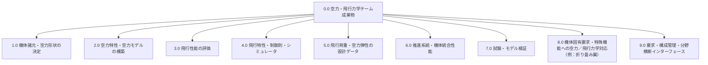

# 航空機設計・空力／飛行力学チーム WBS（改訂 v3.0）

**版**：Draft v3.0（2026-11-17）  
**適用範囲**：一般的な固定翼航空機を対象とする「空力・飛行力学チーム」の成果物／関連インターフェース。機体タイプ、認証根拠、設計フェーズが未指定のため、項目・方法・評価の要否はプロジェクトごとにテーラリングする。  
**番号の意味**：WBS番号は階層識別子であり、優先度・日程・実施順序を意味しない。

## 変更点（Draft 2.0から）

1. **荷重5.0の分類を全面改訂**：荷重要求→解析モデル→ケース選定→運動荷重／突風荷重→荷重分布・構造受渡し→包絡。空力荷重を突風荷重の並列分類にはしない。
2. **機体形状と空力設計の詳細化**：翼型・翼平面形・ねじり・インテーク、CGの実現範囲／許容範囲、形状管理を区別。
3. **制御の分離**：4.3を原則として増強なしの開ループ動安定性、4.5制御則、4.6シミュレータ、4.7閉ループ飛行特性に分割。
4. **試験と解析の品質管理**：VSPAERO／CFDの限界、CFD格子・収束、試験データのシステム同定、数値検証、空力補間の不確かさを追加。
5. **機体固有要求と横断管理**：折り畳み翼／格納制約を8.0、要求ID・構成管理・受渡し・技術リスク・設計判断を9.0で管理。

## 分解と責任範囲の原則

- **上位は成果物（What）、下位はその成果を作るための評価対象**。CFD、DATCOM、VSPAERO、風洞、飛行試験、システム同定は原則「実施手段（How）」欄に置く。重要なCFD解析パッケージ自体を独立した納品物として管理するときは別WBSも許す。
- **階層は技術分野→成果物群→個別成果物／ワークパッケージ**として表す。各レベル4項目に、成果物・担当・完了条件を設定したうえで、実施作業・手段・工数・依存関係は別の実行タスク表に展開する。
- **成果物は1か所で所有**し、他のWBSでは参照する。例：空力DBの発行は2.7、飛行荷重ケースの発行は5.3、重心制約の統合発行は1.4。
- **機体の構造・機構、推進装置単体、制御電子機器、計測装置の詳細設計**は関連部門の成果物。本WBSは空力・飛行力学上の仕様・評価・受渡しを管理する。
- **評価は反復可能**：例えば設計諸元→空力→性能→形状変更を繰り返す。WBSの番号順に進める必要はない。

## 全体構成（Mermaid）

## 0.0 空力・飛行力学設計成果物

機体の空力形状・空力係数モデル・飛行性能・飛行特性／制御・飛行荷重／空力弾性・搭載推進性能・試験検証・機体固有要求対応・要求／構成管理の合計を、管理対象の成果物群とする。

## 1.0 機体諸元・空力形状の決定

### 1.1 機体基本諸元
**主要成果物**：基準諸元表、成立性評価資料  
**代表的な実施手段（候補）**：要求条件の整理、サイジング計算、トレードスタディ  
**レベル4項目**：
- **1.1.1** ミッション・要求条件から基準重量ケースを定義
- **1.1.2** 翼面荷重 W/S の初期設計範囲を設定
- **1.1.3** 推力重量比 T/W・出力重量比 P/W の成立域を設定
- **1.1.4** 翼面積・翼幅・全長・代表寸法の成立域を設定
- **1.1.5** 速度・高度・荷重・格納などの主要設計制約を諸元案に反映

### 1.2 空力コンフィギュレーション
**主要成果物**：空力形状案、構成諸元表  
**代表的な実施手段（候補）**：概念設計、パラメトリックCAD、経験式、VSPAERO、CFD等  
**レベル4項目**：
- **1.2.1** 主翼・尾翼・胴体・推進系の基本配置を選定
- **1.2.2** 主翼平面形（AR・テーパ・後退・上反角）を定義
- **1.2.3** 翼型・翼厚分布・キャンバーを選定
- **1.2.4** ねじり・取付角・翼端形状を定義
- **1.2.5** 尾翼／カナードの配置・容積・形状を定義
- **1.2.6** 高揚力装置・舵面の配置・寸法を定義
- **1.2.7** 胴体・フェアリング・インテーク外形を定義
- **1.2.8** 翼・胴体・推進系の干渉低減形状を評価

### 1.3 質量・重心・慣性の入力データ（重量部門とのIF）
**主要成果物**：重量台帳参照、実現CG包絡、慣性条件セット  
**代表的な実施手段（候補）**：CAD質量特性、質量台帳、搭載・燃料ケース計算  
**レベル4項目**：
- **1.3.1** 重量担当の質量台帳・代表搭載条件を受領
- **1.3.2** 燃料消費・搭載状態別の実現CG包絡を算出
- **1.3.3** 質量分布・慣性テンソル（積・主軸）を受領・検証
- **1.3.4** 質量特性の不確かさ・更新影響を記録
- **1.3.5** 性能・飛行特性・荷重用の重量／CGケースを発行

### 1.4 許容CG範囲・機体制限の統合
**主要成果物**：許容CG包絡線、運用CG制限案  
**代表的な実施手段（候補）**：トリム・安定性・操縦能力解析（4章結果参照）、要求比較  
**レベル4項目**：
- **1.4.1** 前方CG限界の評価結果（トリム・ローテーション等）を統合
- **1.4.2** 後方CG限界の評価結果（静安定・動安定・操縦性等）を統合
- **1.4.3** 重量・速度・形態別の許容CG包絡を作成
- **1.4.4** 実現CG包絡と許容CG包絡の整合性を確認
- **1.4.5** 機体設計への是正要求と暫定運用制限を発行

### 1.5 空力形状の確定
**主要成果物**：承認形状、形状・座標系・基準面積定義  
**代表的な実施手段（候補）**：トレードスタディ、形状レビュー、構成管理  
**レベル4項目**：
- **1.5.1** 形状候補ごとの性能・安定性・荷重トレードオフを記録
- **1.5.2** 基準座標系・基準面積・MAC・基準モーメント点を定義
- **1.5.3** コンフィギュレーション別の形状データを整理
- **1.5.4** 承認CAD・形状諸元・設計判断記録を発行

### 1.6 飛行領域・機体形態の定義
**主要成果物**：設計飛行領域・機体形態リスト・運用制限候補  
**代表的な実施手段（候補）**：要求分析、飛行包絡推定、構成状態定義  
**レベル4項目**：
- **1.6.1** 設計速度・高度・Mach/Re領域を定義
- **1.6.2** 離着陸・巡航・非常時の機体形態を定義
- **1.6.3** 重量・CG・推進運転状態の組合せを定義
- **1.6.4** 形状変更や特殊機構の許容状態を定義

## 2.0 空力特性・空力モデルの構築

### 2.1 縦の静的空力特性
**主要成果物**：CL・CD・Cmテーブル、抵抗極  
**代表的な実施手段（候補）**：DATCOM、経験式、VSPAERO、CFD、風洞試験  
**レベル4項目**：
- **2.1.1** 縦揚力特性 CL(α)・揚力傾斜
- **2.1.2** 抗力極 CD(CL)・有害／誘導／波面抵抗の内訳
- **2.1.3** 縦モーメント特性 Cm(α)・空力中心
- **2.1.4** Mach・Re・高度・形態依存性
- **2.1.5** 取付角・ねじり・平面形変更の感度

### 2.2 横・方向の静的空力特性
**主要成果物**：CY・Cl・Cnの横滑り特性  
**代表的な実施手段（候補）**：DATCOM、VSPAERO、CFD、風洞試験  
**レベル4項目**：
- **2.2.1** CY-β 特性
- **2.2.2** Cl-β 特性
- **2.2.3** Cn-β 特性

### 2.3 動的空力微係数
**主要成果物**：安定微係数表、動的空力モデル  
**代表的な実施手段（候補）**：DATCOM、非定常空力解析、動的風洞試験、システム同定  
**レベル4項目**：
- **2.3.1** 縦の動的空力微係数 Cmq・CLq 等
- **2.3.2** 横・方向の動的微係数 Clp・Clr・Cnp・Cnr 等
- **2.3.3** αdot・βdot等の採否・モデルの仮定
- **2.3.4** 高迎角・非定常・履歴特性の必要性判断
- **2.3.5** 各微係数の推定根拠・信頼度を記録

### 2.4 操縦舵・高揚力装置の空力特性
**主要成果物**：舵効き係数、ヒンジモーメント、フラップ特性  
**代表的な実施手段（候補）**：DATCOM、VSPAERO、CFD、風洞試験  
**レベル4項目**：
- **2.4.1** 縦舵効きとピッチング・揚力変化
- **2.4.2** 横舵効きとロール／ヨー連成
- **2.4.3** 方向舵効きと非対称運転状態
- **2.4.4** 舵角・舵端失速による非線形特性
- **2.4.5** ヒンジモーメントと舵面作動要求
- **2.4.6** 高揚力装置による増揚・抗力・モーメント変化

### 2.5 高迎角・失速特性
**主要成果物**：高迎角空力モデル、失速特性データ  
**代表的な実施手段（候補）**：非線形CFD、風洞試験、飛行試験（適用性に注意）  
**レベル4項目**：
- **2.5.1** CLmax・失速迎角・失速開始部位を評価
- **2.5.2** 前縁／後縁剥離・層流剥離泡等の影響を評価
- **2.5.3** 高迎角でのCm変化・ピッチアップ可能性を評価
- **2.5.4** 失速近傍での横方向非対称・舵効きを評価
- **2.5.5** 高迎角モデルの適用限界・試験要否を記録

### 2.6 空力分布データ
**主要成果物**：圧力分布、翼幅荷重、舵面荷重分布  
**代表的な実施手段（候補）**：VSPAERO、CFD、風洞圧力計測  
**レベル4項目**：
- **2.6.1** 翼幅方向Cl／荷重分布の評価
- **2.6.2** 翼弦方向Cp・摩擦・剥離状態の評価
- **2.6.3** 全機表面圧力・空気力の分布データを作成
- **2.6.4** 荷重解析へ受け渡す分布空気力モデルを定義
- **2.6.5** 形状・速度・迎角・舵角ごとの分布データ版を整備

### 2.7 統合空力モデル
**主要成果物**：多次元空力DB、補間関数、仕様書  
**代表的な実施手段（候補）**：Python/MATLAB等でのデータ統合・補間・感度／不確かさ評価  
**レベル4項目**：
- **2.7.1** 静的・動的・舵効きデータを共通規約で統合
- **2.7.2** 多次元係数テーブルと補間モデルを実装
- **2.7.3** 領域境界・外挿・不連続・飽和処理を定義
- **2.7.4** 空力データの単位／軸／符号／基準点を統一
- **2.7.5** 誤差・相関・不確かさ／適用条件を文書化
- **2.7.6** 形状版・解析版・データ版を対応付けて発行

### 2.8 空力解析品質・手法選定
**主要成果物**：空力評価計画、数値解の品質確認記録  
**代表的な実施手段（候補）**：経験式、DATCOM、VLM/パネル法、CFD、風洞試験、解析V&V  
**レベル4項目**：
- **2.8.1** 必要係数と要求精度から手法・モデル忠実度を選定
- **2.8.2** VSPAERO等の手法制約（粘性・失速・舵面形状）を確認
- **2.8.3** CFD格子・境界条件・収束・格子依存性を検証
- **2.8.4** 計算条件の差異と係数の基準値・抵抗補正方針を記録
- **2.8.5** 解析手法間・試験間の差異と残存不確かさを整理

## 3.0 飛行性能の評価

### 3.1 性能評価の共通条件・計算モデル
**主要成果物**：性能評価基準条件書、入力モデル版リスト  
**代表的な実施手段（候補）**：要求整理、性能計算条件表、空力・推進モデル統合  
**レベル4項目**：
- **3.1.1** 重量・重心・機体形態・搭載条件の定義
- **3.1.2** 高度・大気・風・気温・滑走路条件の定義
- **3.1.3** 空力・推進・燃料／エネルギー・重量モデルの整合
- **3.1.4** 性能計算モデルの検証・モデル版管理

### 3.2 ミッション性能
**主要成果物**：ミッションプロファイル、航続性能表、燃料／エネルギー余裕評価  
**代表的な実施手段（候補）**：ミッション区間積分、燃料／電力収支、軌道計算、試験データ補正  
**レベル4項目**：
- **3.2.1** 運用ミッションと各飛行区間・搭載条件の定義
- **3.2.2** ミッション全体の燃料・エネルギー消費量
- **3.2.3** 航続距離・滞空時間・ペイロード／レンジ性能
- **3.2.4** 予備燃料・運用余裕・代替ミッションの評価
- **3.2.5** ミッション達成率・要求適合性の評価

### 3.3 離陸性能
**主要成果物**：離陸速度・滑走距離・離陸距離・離陸性能表  
**代表的な実施手段（候補）**：地上滑走／遷移軌道計算、地面効果モデル、6DoF、飛行試験  
**レベル4項目**：
- **3.3.1** 離陸形態・重量・大気・滑走路条件の定義
- **3.3.2** 離陸滑走加速度・滑走距離
- **3.3.3** ローテーション速度・機首上げ・浮揚条件
- **3.3.4** 離陸距離・障害物越え条件・初期上昇移行
- **3.3.5** 必要に応じた推進異常・性能低下時の離陸条件

### 3.4 上昇・加速性能
**主要成果物**：上昇率・上昇勾配・加速時間・到達高度の性能曲線  
**代表的な実施手段（候補）**：余剰推力／余剰出力、点質量運動積分、飛行試験  
**レベル4項目**：
- **3.4.1** 高度・速度ごとの余剰推力／出力・上昇能力
- **3.4.2** 最大上昇率・最大上昇勾配と対応速度
- **3.4.3** 上昇中の加速・加速上昇区間の時間・距離
- **3.4.4** 上昇時間・上昇燃料／エネルギー消費
- **3.4.5** 実用上昇限度・必要な上昇経路の成立性

### 3.5 巡航性能
**主要成果物**：巡航条件表・巡航距離／燃料曲線・巡航最適化結果  
**代表的な実施手段（候補）**：定常釣合計算、燃料消費モデル、最適化、飛行試験  
**レベル4項目**：
- **3.5.1** 高度・速度ごとの必要推力／出力
- **3.5.2** 巡航可能領域・実現可能な巡航速度
- **3.5.3** 燃費／電費・比航続距離・比滞空時間
- **3.5.4** 最適巡航高度・最適速度・段階上昇の検討
- **3.5.5** 巡航時の重量・重心変化を含めた性能評価

### 3.6 降下・減速性能
**主要成果物**：降下・減速性能曲線、降下経路・所要距離  
**代表的な実施手段（候補）**：点質量軌道計算、抗力・推力モデル、飛行試験  
**レベル4項目**：
- **3.6.1** 降下率・降下角・降下速度の評価
- **3.6.2** 降下区間の距離・時間・燃料／エネルギー収支
- **3.6.3** 減速時間・減速距離・減速可能範囲
- **3.6.4** 速度制限・機体形態遷移を含む降下経路成立性

### 3.7 着陸性能
**主要成果物**：進入条件・着陸距離・着陸性能表  
**代表的な実施手段（候補）**：進入・フレア・接地・制動の軌道計算、6DoF、飛行試験  
**レベル4項目**：
- **3.7.1** 着陸形態・重量・重心・大気・滑走路条件の定義
- **3.7.2** 進入速度・最小進入速度・進入勾配
- **3.7.3** フレア・接地速度・接地時の状態
- **3.7.4** 着陸滑走・制動距離・総着陸距離
- **3.7.5** 横風や制動性能低下等の必要な条件別評価

### 3.8 速度限界・高度包絡（能力限界）
**主要成果物**：最大・最小飛行速度表、飛行可能領域  
**代表的な実施手段（候補）**：推力／抵抗釣合、失速特性、速度包絡解析、飛行試験  
**レベル4項目**：
- **3.8.1** 最大水平速度と推力・出力による限界
- **3.8.2** 最低定常飛行速度・失速速度（形態別）
- **3.8.3** 速度高度包絡（低速・高速・上昇限界）
- **3.8.4** Mach・動圧・荷重・制御限界との整合
- **3.8.5** 運用速度・使用可能領域の暫定制限

### 3.9 定常旋回性能
**主要成果物**：定常旋回率・旋回半径・旋回性能包絡  
**代表的な実施手段（候補）**：協調旋回釣合、Ps解析、荷重倍数・推力制約を考慮した計算  
**レベル4項目**：
- **3.9.1** 定常協調旋回時の力・推力の釣合い
- **3.9.2** 持続可能な旋回率・旋回半径
- **3.9.3** 瞬間旋回能力（速度・荷重制限下）
- **3.9.4** 重量・高度別の旋回性能図
- **3.9.5** エネルギー維持条件／Psとの整合

### 3.10 その他の機動・エネルギー性能
**主要成果物**：機動性能包絡線、エネルギー機動性能評価  
**代表的な実施手段（候補）**：比余剰出力 Ps、点質量軌道計算、必要に応じた6DoF  
**レベル4項目**：
- **3.10.1** 比余剰出力 Ps・エネルギー獲得能力
- **3.10.2** 引き起こし・機動加速の成立性
- **3.10.3** 代表非定常機動の時間・経路・到達状態
- **3.10.4** 性能・荷重・操縦制約の統合包絡
- **3.10.5** 要求ミッションの機動達成余裕

## 4.0 飛行特性・制御則・シミュレータ

### 4.1 トリム特性
**主要成果物**：トリムテーブル、必要舵角、重心制約  
**代表的な実施手段（候補）**：非線形トリム計算、VSPAERO／空力DB、シミュレーション  
**レベル4項目**：
- **4.1.1** 縦トリム（舵角・迎角・推進状態）
- **4.1.2** 横・方向トリム（横滑り・舵角・推力非対称）
- **4.1.3** トリム限界・舵角／舵角速度余裕
- **4.1.4** 前方・後方CG境界の解析結果を発行
- **4.1.5** 制御系作動状態・飛行形態ごとのトリム表

### 4.2 静安定性
**主要成果物**：中立点、静安定余裕、横・方向安定性評価  
**代表的な実施手段（候補）**：空力微係数評価、トリム線形化、DATCOM等  
**レベル4項目**：
- **4.2.1** 縦静安定：中立点・静安定余裕
- **4.2.2** 横静安定：上反角効果・Clβ等
- **4.2.3** 方向静安定：Cnβ等
- **4.2.4** 舵面固定／自由・制御増強の有無を明示
- **4.2.5** 重量・CG・飛行条件別の静安定余裕

### 4.3 開ループ（非増強）動安定性
**主要成果物**：機体固有モード、固有値・減衰比・固有振動数、モデル境界定義  
**代表的な実施手段（候補）**：制御則による安定増強を除いた線形運動方程式、固有値解析、飛行試験同定  
**レベル4項目**：
- **4.3.1** 無増強機体モデルの軸系・状態変数・舵面境界を定義
- **4.3.2** 短周期・フゴイドの縦モードを評価
- **4.3.3** ダッチロール・ロール収束・スパイラルを評価
- **4.3.4** CG・高度・速度・推進条件に対する感度
- **4.3.5** 開ループ操舵応答・モード観測可能性を評価
- **4.3.6** 不安定領域・飛行制御への要求を発行

### 4.4 機体固有の操縦能力・基本飛行性
**主要成果物**：操縦応答、操縦能力、Handling Qualities評価  
**代表的な実施手段（候補）**：舵効き解析、時系列シミュレーション、操縦者評価・試験  
**レベル4項目**：
- **4.4.1** 舵効き・操縦権限・舵角余裕を評価
- **4.4.2** 開ループ操縦応答・過渡特性を評価
- **4.4.3** 操縦力・ヒンジモーメント・アクチュエータ条件を評価
- **4.4.4** パイロットを含む飛行性評価の基準を整理
- **4.4.5** 失速付近・エンジン故障等の操縦性を評価

### 4.5 制御則設計
**主要成果物**：制御則仕様・実装、ゲイン表、安定余裕・性能評価  
**代表的な実施手段（候補）**：制御系設計、線形解析、非線形シミュレーション、SIL/HIL  
**レベル4項目**：
- **4.5.1** 制御則要求・制御対象・モード構成を定義
- **4.5.2** 安定増強（SAS）・姿勢・速度・高度制御則を設計
- **4.5.3** 飛行条件・CGに応じたゲインスケジュールを設計
- **4.5.4** 舵角・舵角速度飽和とアンチワインドアップを検証
- **4.5.5** 遅れ・センサ・アクチュエータ誤差を考慮
- **4.5.6** 故障モード・リコンフィギュレーション／保護機能を定義
- **4.5.7** 制御則コード・パラメータ・検証結果を発行

### 4.6 飛行シミュレータ構築
**主要成果物**：6DoF実行モデル、入出力仕様、検証結果  
**代表的な実施手段（候補）**：Python/MATLAB/Simulink等、単体試験、モデル検証  
**レベル4項目**：
- **4.6.1** 6DoF剛体運動方程式・座標系・積分器を実装
- **4.6.2** 空力・推進・重量・慣性・接地等のモデルを組込み
- **4.6.3** 大気・風・突風・必要なセンサ／アクチュエータを模擬
- **4.6.4** 制御則・操縦入力・ログのインターフェースを設計
- **4.6.5** 数値安定性・単体試験・基準ケースを整備
- **4.6.6** シミュレータ版と各入力モデル版を追跡
- **4.6.7** SIL/HIL／操縦者評価への拡張要否を整理

### 4.7 閉ループ飛行特性評価
**主要成果物**：閉ループ飛行性、ロバスト性、故障応答評価書  
**代表的な実施手段（候補）**：線形周波数応答、非線形シミュレーション、SIL/HIL  
**レベル4項目**：
- **4.7.1** 制御則を含む閉ループ極・安定余裕を評価
- **4.7.2** 指令追従・過渡応答・飛行性を評価
- **4.7.3** 広域飛行条件・CG変化に対するロバスト性
- **4.7.4** 突風・外乱応答・操舵飽和の影響
- **4.7.5** 故障・異常時の閉ループ機能・残存能力
- **4.7.6** 制御則要求への適合・残存リスクを報告

### 4.8 飛行領域・異常時の飛行性
**主要成果物**：飛行性制限案、異常時応答評価書  
**代表的な実施手段（候補）**：6DoF・非線形解析、操縦者評価、飛行試験（承認範囲のみ）  
**レベル4項目**：
- **4.8.1** 失速・高迎角・スピン等の対象／非対象を定義
- **4.8.2** 速度・CG・故障状態ごとの飛行可能性を評価
- **4.8.3** 異常状態からの回復・操作余裕を評価
- **4.8.4** 制御機能・運用制限を設計側に提案

## 5.0 飛行荷重・空力弾性の設計データ

### 5.1 荷重要求・設計領域
**主要成果物**：適用設計要求、速度・重量CG・形態／荷重条件仕様  
**代表的な実施手段（候補）**：認証・設計要求の解析、運用包絡、関係部門レビュー  
**レベル4項目**：
- **5.1.1** 適用基準・設計要求・安全係数の体系化
- **5.1.2** 設計速度・高度・重量・CG・形態の範囲
- **5.1.3** 制限荷重・終極荷重・変形条件の定義
- **5.1.4** 構造部門へのデータ／判定条件インターフェース

### 5.2 荷重解析モデル・モデル境界
**主要成果物**：空力・剛体／弾性体・質量・制御系の結合モデル定義  
**代表的な実施手段（候補）**：空力モデル、質量モデル、構造モード、トリム・制御則、モデルV&V  
**レベル4項目**：
- **5.2.1** 荷重解析用の空力モデル（定常／非定常）を選定
- **5.2.2** 質量・慣性・弾性モードの条件を統合
- **5.2.3** トリム・操舵・制御則の扱いを定義
- **5.2.4** 空力／慣性／弾性荷重の計算境界を定義
- **5.2.5** モデル妥当性・適用範囲・バージョンを記録

### 5.3 荷重ケース定義・スクリーニング
**主要成果物**：荷重ケースマトリクス、ケース採否理由、計算計画  
**代表的な実施手段（候補）**：要求対応、V-n包絡、風・突風条件、事前感度解析  
**レベル4項目**：
- **5.3.1** 運動・操舵・旋回・非対称推力ケースを列挙
- **5.3.2** 突風・乱気流の設計条件とケースを列挙
- **5.3.3** 重量・CG・高度・速度・形態の組合せを設計
- **5.3.4** 荷重ケースID・入力条件・評価対象部位を定義
- **5.3.5** 予備計算で候補ケースを絞り込み根拠を記録
- **5.3.6** ケース網羅性を構造・制御担当とレビュー

### 5.4 飛行運動・操舵荷重
**主要成果物**：運動荷重時系列・部位別荷重計算結果  
**代表的な実施手段（候補）**：釣合運動解析、動的6DoF、操舵則、CFD／パネル法  
**レベル4項目**：
- **5.4.1** 引き起こし・押し下げ・旋回の運動荷重
- **5.4.2** 横転・偏揺・舵操作の運動荷重
- **5.4.3** 非対称推力・故障時の運動荷重
- **5.4.4** 機体剛体・弾性応答と操舵連成
- **5.4.5** 重量CG・速度・形態に対するクリティカル条件

### 5.5 突風・乱気流荷重
**主要成果物**：離散突風・連続乱気流の応答・荷重結果  
**代表的な実施手段（候補）**：離散突風モデル、非定常空力、時刻歴／周波数応答  
**レベル4項目**：
- **5.5.1** 適用要求に基づく離散突風入力を定義
- **5.5.2** 突風遭遇の時系列応答・荷重を解析
- **5.5.3** 連続乱気流の統計／PSD応答を解析
- **5.5.4** 剛体／弾性体・制御系の影響を評価
- **5.5.5** 突風条件別のクリティカルケースを抽出

### 5.6 荷重分布・構造インターフェース
**主要成果物**：空気力・慣性力分布、断面力、構造モデル入力パッケージ  
**代表的な実施手段（候補）**：分布圧力、分布力積分、質量分布、荷重マッピング  
**レベル4項目**：
- **5.6.1** ケースごとの空気力・圧力分布を集計
- **5.6.2** 慣性力・推進力・重力等との釣合いを確認
- **5.6.3** 翼・尾翼・胴体等の断面力・モーメントを算出
- **5.6.4** 構造節点／荷重点への変換と力・モーメント保存を検証
- **5.6.5** 同時性を保った力・モーメント成分セットを発行

### 5.7 静・動空力弾性／空力サーボ弾性
**主要成果物**：変形影響、ダイバージェンス・舵効き逆転・フラッタ境界  
**代表的な実施手段（候補）**：構造・空力連成、固有値解析、非定常空力、GVTデータ  
**レベル4項目**：
- **5.7.1** 静的変形による空力分布・安定性の変化
- **5.7.2** ダイバージェンス・舵効き低下／逆転
- **5.7.3** 構造モード・フラッタ境界の評価
- **5.7.4** 制御則を含むエアロサーボエラスティシティ
- **5.7.5** 空力弾性条件の荷重ケースへのフィードバック

### 5.8 荷重包絡・クリティカルケース
**主要成果物**：構造部位別荷重包絡、支配ケース、設計荷重データパッケージ  
**代表的な実施手段（候補）**：荷重ソート、部位別最大値・組合せ、レビュー  
**レベル4項目**：
- **5.8.1** 翼・尾翼・胴体等の設計部位別包絡を作成
- **5.8.2** 多軸荷重の組合せ・同時刻荷重を抽出
- **5.8.3** 支配ケースID・入力条件・発生理由を記録
- **5.8.4** 構造設計用データパッケージと改訂履歴を発行
- **5.8.5** 要求／ケース漏れ・余裕・残存課題をレビュー

### 5.9 地上・離着陸関連荷重の連携
**主要成果物**：地上運動荷重の空力・推進側入力、担当境界表  
**代表的な実施手段（候補）**：地上滑走運動、離着陸シミュレーション、脚／構造チームIF  
**レベル4項目**：
- **5.9.1** 着陸衝撃・地上滑走・制動／旋回の対象範囲を整理
- **5.9.2** 離着陸時の揚力・抗力・推進力時系列を受け渡す
- **5.9.3** 脚・機体構造への地上荷重解析責任を明示
- **5.9.4** 地上荷重と飛行荷重の共通ケースの整合を確認

## 6.0 推進系統・機体統合性能

### 6.1 推進性能モデル
**主要成果物**：エンジン／プロペラ特性データ  
**代表的な実施手段（候補）**：推進担当データ受領、ベンチ・地上試験、性能補間  
**レベル4項目**：
- **6.1.1** エンジン単体の推力・出力・燃費マップを受領
- **6.1.2** プロペラ／ファンの効率・推力・トルク特性を受領
- **6.1.3** 回転数・トルク・出力の運転点整合を評価
- **6.1.4** 高度・速度・温度・作動条件別の利用可能推進能力
- **6.1.5** 推進モデルの入力仕様・適用制約を明示

### 6.2 搭載推進性能
**主要成果物**：吸排気損失、正味搭載推進モデル  
**代表的な実施手段（候補）**：インテーク・排気流解析、CFD、推進計算、試験  
**レベル4項目**：
- **6.2.1** 搭載推力・出力の定義と非搭載基準との差を整理
- **6.2.2** インテーク圧力回復・AIP流れのひずみを評価
- **6.2.3** 吸気流量・エンジン境界条件・外部流との整合
- **6.2.4** 排気・ナセル・冷却系の機体干渉と外部抵抗
- **6.2.5** 正味搭載推進能力と飛行性能への受渡し

### 6.3 推進・空力干渉
**主要成果物**：推進作動による全機空力係数差分モデル  
**代表的な実施手段（候補）**：プロペラ後流計算、CFD、風洞試験、飛行試験  
**レベル4項目**：
- **6.3.1** プロペラ後流・旋回流／ジェット噴流を評価
- **6.3.2** 翼・胴体・尾翼・舵面への干渉を評価
- **6.3.3** 推進ON/OFFの空力係数差分を定義
- **6.3.4** 推進状態変化に伴うトリム・静安定への影響
- **6.3.5** 推進干渉モデルを空力DBに受け渡す

### 6.4 推進非対称・故障条件
**主要成果物**：非対称時の性能・安定操縦性評価  
**代表的な実施手段（候補）**：推進／空力連成、トリム・6DoF解析、試験  
**レベル4項目**：
- **6.4.1** 非対称推力による力・モーメントを評価
- **6.4.2** エンジン故障時の最低制御可能速度等の適用要否
- **6.4.3** 非対称運転時のトリム・飛行性能制限
- **6.4.4** 非対称時の飛行荷重・制御要求を関連WBSへ連携

### 6.5 吸気・排気・冷却の空力インターフェース
**主要成果物**：吸排気ダクト評価データ、AIP・外部流境界仕様  
**代表的な実施手段（候補）**：内部／外部CFD、AIPモデル、流量境界、試験  
**レベル4項目**：
- **6.5.1** インテーク配置・捕捉流量・使用飛行領域を定義
- **6.5.2** AIP圧力回復率・ディストーション指標を評価
- **6.5.3** エンジン境界条件の感度と質量流量整合を確認
- **6.5.4** 入口スピレージ・外部抵抗・境界層吸込みを評価
- **6.5.5** 高迎角・横滑り・推進状態変化での吸気性能を評価

## 7.0 試験・モデル検証

### 7.1 検証計画
**主要成果物**：V&V計画、要求と検証項目の対応表  
**代表的な実施手段（候補）**：要求トレーサビリティ、検証方法選択、精度計画  
**レベル4項目**：
- **7.1.1** 要求ID・重要な技術仮説と検証方法を対応付け
- **7.1.2** 試験・解析・検査による検証マトリクスを作成
- **7.1.3** 評価精度・不確かさ・合否判定基準を定義
- **7.1.4** 試験で識別すべき係数・飛行条件を定義
- **7.1.5** 試験準備・安全・構成管理のインターフェースを定義

### 7.2 地上・風洞試験
**主要成果物**：試験条件書、補正済み計測データ  
**代表的な実施手段（候補）**：風洞試験、地上振動試験、構造計測、品質管理  
**レベル4項目**：
- **7.2.1** 風洞の測定条件・模型仕様と補正方法を定義
- **7.2.2** 空力係数・圧力分布・高迎角等の試験を計画
- **7.2.3** 地上振動・構造／舵面試験のデータ需要を整理
- **7.2.4** 計測校正・計測不確かさ・基準座標を管理
- **7.2.5** 補正済み試験データと品質記録を発行

### 7.3 飛行試験
**主要成果物**：飛行試験解析データ、性能・飛行特性評価、同定結果  
**代表的な実施手段（候補）**：飛行試験計画、計測、前処理、統計解析、システム同定  
**レベル4項目**：
- **7.3.1** 飛行試験で検証する性能・操縦／安定項目を定義
- **7.3.2** 入力励振・計測チャンネル・飛行条件を設計
- **7.3.3** センサ校正・時間同期・大気／対気補正を実施
- **7.3.4** 飛行性能・操縦応答・飛行荷重等を推定
- **7.3.5** 空力微係数・システム運動モデルを同定
- **7.3.6** 同定可能性・残差・信頼区間／再現性を評価

### 7.4 モデル検証・更新
**主要成果物**：モデル比較結果、誤差表、承認済み改訂モデル  
**代表的な実施手段（候補）**：解析・試験比較、感度解析、不確かさ推定、構成管理  
**レベル4項目**：
- **7.4.1** 計算・風洞・飛行試験の比較指標を定義
- **7.4.2** 解析手法と物理モデルの誤差要因を分離
- **7.4.3** 係数・性能・応答の差異と不確かさを定量化
- **7.4.4** モデル変更提案をデータオーナーへ返却
- **7.4.5** 更新モデルの再検証・承認を行う

### 7.5 解析・シミュレーションの検証（Verification）
**主要成果物**：数値解検証報告、基準テストセット  
**代表的な実施手段（候補）**：格子収束、コード比較、単体・統合試験  
**レベル4項目**：
- **7.5.1** CFDの残差・保存則・格子依存性等を確認
- **7.5.2** 空力補間関数の境界値・外挿・微分を検査
- **7.5.3** 6DoF・性能計算・荷重計算の数値／単位試験
- **7.5.4** 解析入力データの版・再実行性を確認
- **7.5.5** 検証結果と残存制限を文書化

## 8.0 機体固有要求・特殊機能への空力／飛行力学対応（例：折り畳み翼）

### 8.1 機体固有要求・運用制約の定義
**主要成果物**：格納・運用制約要求書、要求トレーサビリティ、インターフェース条件  
**代表的な実施手段（候補）**：運用シナリオ整理、格納庫／搬送経路寸法照合、機構・構造担当との要求レビュー  
**レベル4項目**：
- **8.1.1** 格納寸法・クリアランス・搬送経路の要求を定義
- **8.1.2** 展開／格納時間・人員・環境・地上風条件を定義
- **8.1.3** 着脱・折り畳み・分割収納等を比較して要求を満たす方式を選定
- **8.1.4** 地上限定・飛行中可否と誤操作禁止状態を定義
- **8.1.5** 構造・機構・制御・空力の責任分界と検証方法を定義

### 8.2 格納形態・展開形態の空力形状定義
**主要成果物**：格納／展開形状定義、機構インターフェース形状、形状再現性要求  
**代表的な実施手段（候補）**：CAD干渉・クリアランス評価、空力形状比較、位置再現性・公差設計レビュー  
**レベル4項目**：
- **8.2.1** 格納状態・展開状態の外形と寸法を定義
- **8.2.2** ヒンジ・結合部・段差・隙間の空力影響を評価
- **8.2.3** 翼型・ねじり・取付角・舵面中立点の再現性要求
- **8.2.4** 不完全展開・形状差分の評価範囲を決定
- **8.2.5** 承認された形態定義を形状管理へ受け渡す

### 8.3 特殊機能に伴う質量・飛行特性への影響
**主要成果物**：追加質量・重心・慣性への影響、展開後の飛行性能・飛行特性影響表  
**代表的な実施手段（候補）**：質量台帳、CG計算、空力係数差分解析、トリム・安定操縦性解析  
**レベル4項目**：
- **8.3.1** 機構増加質量と重量・重心・慣性への影響
- **8.3.2** 展開状態の空力・飛行性能・静安定への影響
- **8.3.3** 展開位置公差による舵効き・トリム変化
- **8.3.4** 特定形態・故障状態の運用限界を提案

### 8.4 特殊機能に伴う荷重・安全インターフェース
**主要成果物**：ヒンジ／ロック部への受渡し荷重、異常状態ケース、運用安全要求  
**代表的な実施手段（候補）**：荷重ケース分析、空力・構造連成、機構安全性レビュー、故障モード分析  
**レベル4項目**：
- **8.4.1** 展開／格納時の地上風荷重・慣性力を定義
- **8.4.2** 結合部・ヒンジ・ロック部の機体側設計荷重を定義
- **8.4.3** 結合部剛性・ガタの空力弾性影響を評価
- **8.4.4** ロック未完了・誤作動等の故障影響を分析
- **8.4.5** 機構・構造・安全設計部門へ条件を引き渡す

### 8.5 特殊機能の確認・検証
**主要成果物**：寸法・操作・展開再現性・関連空力特性の検証報告書  
**代表的な実施手段（候補）**：モックアップ、地上展開試験、計測・繰返し試験、風洞／飛行試験（適用時）  
**レベル4項目**：
- **8.5.1** 格納庫との寸法・搬送／取扱いの適合確認
- **8.5.2** 地上での展開・格納・ロック再現性試験
- **8.5.3** 形状公差・繰返し・結合剛性の試験確認
- **8.5.4** 空力／飛行特性モデルの差分検証
- **8.5.5** 要求適合と残存リスク・運用制限を記録

## 9.0 要求・構成管理・分野横断インターフェース

### 9.1 要求・適合性マトリクス
**主要成果物**：要求仕様・要求ID/WBS/検証対応表  
**代表的な実施手段（候補）**：要求分解、要求レビュー、RTM  
**レベル4項目**：
- **9.1.1** 飛行性能・飛行特性・荷重・機体固有要求を識別
- **9.1.2** WBS成果物と要求IDを対応付け
- **9.1.3** 要求値・条件・検証方法・判定基準を管理
- **9.1.4** 要求変更・逸脱と影響範囲を記録

### 9.2 構成・モデル版管理
**主要成果物**：形状／空力／推進／質量／制御／荷重／試験の版台帳  
**代表的な実施手段（候補）**：Git等の構成管理、版リスト、変更申請  
**レベル4項目**：
- **9.2.1** 各設計ベースラインと適用日／版を定義
- **9.2.2** 解析ケースと入力形状・モデル版・ソフト版を紐づけ
- **9.2.3** 設計変更の影響分析・再計算要否を管理
- **9.2.4** 公認モデルと暫定モデルを区別
- **9.2.5** 発行・レビュー・承認・アーカイブルールを定義

### 9.3 データ・インターフェース仕様
**主要成果物**：受渡し仕様書、データ辞書、責任分界表  
**代表的な実施手段（候補）**：インターフェース管理、ICD、座標・単位規約  
**レベル4項目**：
- **9.3.1** 空力→性能・荷重・制御の入力仕様を定義
- **9.3.2** 重量・推進・構造からの入力仕様を定義
- **9.3.3** 座標系・符号・単位・基準点を統一
- **9.3.4** 入力欠損・未確定値・更新時通知ルールを定義
- **9.3.5** 受渡しテストと受領承認を記録

### 9.4 技術リスク・不確かさ・解析仮定
**主要成果物**：技術リスク台帳・不確かさ／仮定一覧  
**代表的な実施手段（候補）**：感度解析、Monte Carlo、技術レビュー  
**レベル4項目**：
- **9.4.1** 主要技術仮説・成立条件を登録
- **9.4.2** モデル・試験・製造・質量の不確かさを定義
- **9.4.3** 性能／安定性／荷重の感度・伝播を評価
- **9.4.4** 優先検証事項とリスク低減計画を決定
- **9.4.5** 有効でなくなった前提・モデル版を追跡

### 9.5 設計レビュー・判断記録
**主要成果物**：技術ゲート資料、設計判断ログ、課題管理表  
**代表的な実施手段（候補）**：DR、トレードスタディ、変更管理、審査  
**レベル4項目**：
- **9.5.1** 各設計段階の出口基準と受入成果物を定義
- **9.5.2** コンフィギュレーション・採用案の判断根拠を記録
- **9.5.3** 未解決課題・アクション・担当・期限を管理
- **9.5.4** 試験／解析結果の審査・更新要求を発行
- **9.5.5** 次フェーズ移行の残存リスクを承認

## 実施手段・タスク表との結びつけ方

| WBS | 完了させる成果物（What） | 実行タスク例（Do） | 手段（How） | 完了条件の例 |
|---|---|---|---|---|
| 1.4.3 | 許容CG包絡 | 重心前後限界を統合 | トリム・安定／操縦性解析 | 重量・飛行条件別の許容CG境界が文書化 |
| 2.7.2 | 空力補間モデル | 複数飛行条件データの補間実装 | Python/MATLAB・試験比較 | 補間・単位・符号・境界のテスト完了 |
| 3.2.3 | ミッション航続評価 | ミッション区間の積分 | 性能計算・燃料／出力モデル | 対象ミッションの航続・滞空が再現可能 |
| 4.3.2 | 非増強時の縦運動モード | 短周期・フゴイド固有値を計算 | 線形化・固有値解析 | 状態定義・飛行条件・固有値が追跡可能 |
| 4.5.3 | ゲインスケジュール | CG・速度のゲイン探索 | 制御設計・6DoF | 閉ループ評価へ受渡せる制御則版 |
| 5.3.4 | 荷重ケースマトリクス | 各荷重ケースにIDと入力を付与 | 要求整理・予備荷重解析 | ケース漏れをレビュー済み |
| 5.5.2 | 突風応答結果 | 離散突風の時系列応答を計算 | 非定常空力・時刻歴計算 | 荷重時系列と発生条件が保存済み |
| 6.5.2 | インテーク性能指標 | AIP圧力回復・ひずみを評価 | 内部／外部CFD | 境界条件・結果・精度が記録済み |
| 7.3.5 | 飛行試験同定モデル | 空力・運動モデルを同定 | 飛行試験データ解析 | 同定可能性・残差・信頼区間を提示 |
| 8.1.3 | 格納方式の選定根拠 | 折り畳み／着脱等を比較 | CAD・重量・運用トレード | 選定基準と採否理由を記録 |

## WBS Dictionary記載例

詳細な作業定義は別ファイル／Excelの「Dictionary」シートに掲載。ここでは主要な項目だけ説明する。

### 例A：5.3 荷重ケース定義・スクリーニング

- **目的**：機体の適用要求・重量CG・速度・高度・形態・操舵／突風条件に対して、評価が必要な荷重ケースを識別する。
- **入力**：要求ID／基準、運用包絡、重量CG・慣性、空力モデル、構造・制御側の設計条件。
- **成果物**：荷重ケースマトリクス（ケースID、荷重源、入力条件、先行モデル版、対象部位、解析方法、採否理由）。
- **作業と手段**：要求レビュー→候補生成→予備解析→ケース優先度・クリティカル候補の絞込み→レビュー。V-n、飛行運動解析、突風設計条件など。
- **完了条件**：要求との対応が確認され、構造／飛行制御担当にレビュー・承認されたケース一覧を受け渡した状態。
- **対象外**：構造強度の最終判定、各ケースの詳細荷重解そのもの（5.4/5.5/5.6）。

### 例B：2.7 統合空力モデル

- **目的**：性能・飛行特性・荷重が共通に参照できる空力係数モデルを発行する。
- **入力**：形状版、DATCOM/VSPAERO/CFD等の解析結果、試験検証結果、軸・単位・基準点。
- **成果物**：係数テーブル／補間コード、仕様書、精度・適用範囲、依存モデル版リスト。
- **作業と手段**：データ整合→不足領域の評価計画→補間実装→外挿／境界／単位テスト→検証・承認。
- **完了条件**：基準ケースでの再現性、補間境界・物理妥当性、データ出典と版が確認可能。
- **対象外**：CFDソルバそのものの開発、他分野による飛行性能結果の合否判定。

## 実務導入時のルール

1. WBS番号に優先度や進捗率を埋め込まない。優先度、担当、工数、予定・実績、先行タスクはタスク表の列で管理。
2. 実行タスクは「成果物確認・レビュー可能」な区切りで管理する。半日～2日という粒度は初期目安で、長時間計算・試験準備は中間チェックを別設計する。
3. レベル4から下は、必ずしもWBS階層を増やさず、タスクID（例：T-001）を付与してタスク表に切り出す。
4. 依存関係はWBSツリーではなくタスク表で管理する。出力モデルの受領・承認をマイルストーンとして明示する。
5. 機体固有要求（8.0）は必要時にだけ詳細化。要求IDを1.0～7.0や9.0に横断リンクし、同一成果物を二重計上しない。
6. このWBSは空力・飛行力学のスコープ見本であり、耐空性認証への適合や解析・試験の網羅を保証するものではない。

## 文献・根拠と適用範囲

- **Sadraey, *Aircraft Design: A Systems Engineering Approach***（プロジェクト資料 `Mohammad_H_Sadraey_Aircraft_Design_A_Sys.pdf`）：Chapter 2 §§2.3–2.8（システム設計・要求・レビュー・設計分野）、Chapter 4 §4.3（翼面積／エンジンサイジング）、Chapter 5 §§5.4–5.16（翼型・平面形・ねじり・舵面）、Chapter 6 §§6.2–6.9（トリム・尾翼・操縦）。**本WBSの項目列挙や番号は原著のWBSではなく、こちらの設計案。**
- **Etkin & Reid, *Dynamics of Flight: Stability and Control***（`dynamics_of_flight_by_etkins.pdf`）：Chapter 2–3（静安定・操縦・CG限界）、Chapter 5（安定微係数）、Chapter 6（増強なしの安定性）、Chapter 7（開ループ操舵応答）、Chapter 8（閉ループ制御）。
- **Nelson, *Flight Stability and Automatic Control***（`Flight_Stability_and_Automatic_Control_N.pdf`）：Chapter 2–6（静安定、動安定、飛行性、応答）、Chapter 7–10（制御系・自動操縦系）。
- **Wright & Cooper, *Introduction to Aircraft Aeroelasticity and Loads*, 2nd ed.**（`IntroAircraftAeroelasticityLoads.pdf`）：Chapter 20–21（認証・解析モデル）、Chapter 23（運動・突風荷重）、Chapter 24（地上荷重）、Chapter 25（試験との対応）。本WBSの5.0の再編根拠。
- **NASA, *Work Breakdown Structure Handbook* (NASA/SP-3404)**：[NASAの公開資料](https://ntrs.nasa.gov/citations/20210023927)（成果物指向のWBS・Dictionaryの管理）。
- **NASA, *Systems Engineering Handbook***：[NASA公開資料](https://www.nasa.gov/reference/system-engineering-handbook-appendix/)（要求対応・検証マトリクスの扱い）。
- **その他の既往議論からの設計判断**：主翼平面形／翼型／ねじり、VSPAERO舵面・CD0、プロペラ運転点、インテークAIP、飛行試験システム同定、重心と解析不確かさ。これらは資料そのものに含まれるWBSではなく、本プロジェクトの技術課題として追加した。
